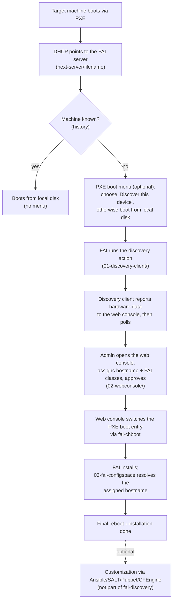

# Architecture

fai-discovery consists of four independent but cooperating components.
None of them requires a particular configuration management tool —
fai-discovery's job ends with the finished FAI installation. From
there, well-known configuration tools such as Ansible/SALT/Puppet/
CFEngine can take over for targeted customization of the installed
system.

## Flow

1. **Target machine boots via PXE.** The DHCP server points it at the
   FAI server (`next-server`/`filename` options). A DHCP server with
   ISC-dhcpd-compatible PXE boot options (next-server/filename) and a
   DNS server for dynamic updates of hostname and IP is required, e.g.
   Technitium DNS.
2. **Unknown machine: PXE boot menu (optional).** A machine without a PXE
   config of its own (`pxelinux.cfg/01-<mac>`) falls back to
   `pxelinux.cfg/default`. With the boot menu enabled
   (`FAI_DISCOVERY_MENU_ENABLED=true`, see below) it shows a menu: discovery
   only starts when **"Discover this device (register for network install)"**
   is chosen. If nobody picks anything, the machine boots from its local disk
   when the countdown ends (default 10 s, `FAI_DISCOVERY_MENU_TIMEOUT`) — a
   brand-new machine therefore has to be told to discover itself. Without the
   menu there is no self-registration: `default` is then a plain `localboot`,
   and the admin puts the machine into discovery mode by MAC address on the
   web console's **Discovery** page. Known machines (everything in the
   history) never see the menu.
3. FAI has no built-in `discovery` action — it is implemented as a
   custom hook (`01-discovery-client/fai-config/hooks/discovery`). The
   hook collects hardware data (MAC, IP, CPU, RAM, disk size,
   UEFI/BIOS firmware, serial number/UUID) and reports it via
   `POST /register` to the web console. It then polls
   `GET /status/<mac>` until the admin has approved the device.
4. The admin opens the web console (`02-webconsole/`), sees the
   waiting machine with its hardware data, assigns a hostname (with
   suggestions from type/location prefixes as well as a serial/UUID
   fragment) and picks FAI classes from a configured profile file.
   Approving triggers `fai-chboot` server-side.
5. `fai-chboot` switches the target machine's PXE boot entry to the
   real installation — including automatically detecting whether an
   `_EFI` variant of the chosen `disk_config` class exists (UEFI vs.
   BIOS/legacy partitioning).
6. The target machine reboots and FAI installs. During the
   installation, `03-fai-configspace/fai-config/class/02-set-hostname.sh`
   queries the web console for the previously assigned hostname and
   sets it both in the running system and via FAI's `additional.var`
   mechanism for later scripts.
7. After the final reboot, the installation is done. This is where
   fai-discovery's job ends — from here, well-known configuration
   tools such as Ansible/SALT/Puppet/CFEngine can take over for
   targeted customization of the installation (e.g. via a solution
   that registers itself on first boot).
8. `install.sh` (`05-portabilitaet-install/`) automates setting up a
   new FAI server with all the components from steps 1–6. If you don't
   want to run someone else's script, the equivalent manual steps are
   in [`installation-manual.md`](installation-manual.md).

## Where each component runs

| Component | Runs on |
|---|---|
| `01-discovery-client/fai-config/hooks/discovery` | Inside the FAI NFSROOT, executed by the target machine during the discovery boot |
| `02-webconsole/` | On the FAI server (systemd service, Flask, port 8080) |
| `03-fai-configspace/fai-config/class/02-set-hostname.sh` | Inside the FAI NFSROOT, executed by the target machine during the actual installation |
| `05-portabilitaet-install/../install.sh` | Once on a new FAI server, for the initial setup |
| `02-webconsole/bin/fai-discovery-menu` | On the FAI server (optional): builds the PXE boot menu and maintains the Syslinux modules |
| `02-webconsole/bin/fai-discovery-known` | On the FAI server (optional, systemd path unit + timer): keeps known machines away from the boot menu |

## PXE boot menu (optional)

With `FAI_DISCOVERY_MENU_ENABLED=true`, `pxelinux.cfg/default` — what every
machine without a PXE config of its own falls back to — becomes a menu with
the entries **"Boot from local disk"** (chosen automatically when the
countdown ends) and **"Discover this device (register for network install)"**.
A new machine can thus register itself without anyone entering its MAC
address first.

- `fai-discovery-menu` writes that `default` file and maintains the Syslinux
  modules. BIOS and UEFI need different builds of `menu.c32` and friends that
  share the same file names: BIOS keeps them in the TFTP root, UEFI in
  `efi64/` (loaded via a DHCP boot file `fai/efi64/syslinux.efi`).
- **Known machines never see the menu.** `fai-discovery-known` reads the
  device database and writes `pxelinux.cfg/01-<mac>` with `localboot -1` for
  every machine with status `reboot` or `reinstalling`, i.e. everything in the
  history. Syslinux prefers the MAC-specific file, so these machines boot from
  disk directly. Only files carrying its own marker line are ever replaced or
  removed: a running installation, discovery or wipe config is never touched,
  and `fai-chboot` simply overwrites the marker file on approval or
  reinstallation. Deleting a history entry makes the machine unknown again
  (the file disappears within about a minute). A path unit on
  `pxelinux.cfg/` reacts when FAI renames its config at the end of an
  installation; a one-minute timer picks up database changes. If the database
  cannot be read, nothing is changed.

Setup and the required rollout order:
[`installation-webconsole.md`](installation-webconsole.md#10-pxe-boot-menu-for-unknown-machines-optional).

## Data model

The web console keeps the state of every reported device (MAC address
as the key) in a SQLite database: `waiting` (reported, awaiting
approval), `reboot` (approved, awaiting the final reboot), `reinstalling`
(sent back to discovery from the history), `discarded` (manually discarded). Admin accounts are kept separately in
`/etc/fai-discovery/admins.json` (HTTP Basic Auth, see
[`installation-webconsole.md`](installation-webconsole.md)).

## Securely wipe (ShredOS)

Two buttons per history entry (only for devices with status `reboot`,
i.e. already installed): **"Securely wipe (PXE)"** writes a PXE boot
config for that one MAC via the `wipe` subcommand, so the next network
boot starts [ShredOS](https://github.com/PartialVolume/shredos.x86_64)
(nwipe-based) instead of FAI — with a double confirmation
(hostname+MAC), disabled if the device's firmware type is unknown.
**"Reset PXE"** reverses that via `disable <mac>` — a deliberate manual
step, since ShredOS runs offline and can't call back to the web console
once it's done.

The kernel lives at `/srv/tftp/fai/shredos/vmlinuz` on the FAI server
(current ShredOS releases ship a single self-contained `bzImage`, no
separate `initrd`) — not checked into this repo (a ~350MB binary, past
GitHub's 100MB push limit). Fetch it with
[`fetch-shredos-kernel.sh`](fetch-shredos-kernel.md), which downloads
the current release, verifies its checksum and extracts the kernel
automatically.

One PXE config works for both BIOS and UEFI: the actual UEFI boot path
goes through `syslinux.efi`, which reads the same PXELINUX config
format as BIOS — no separate GRUB branch needed.
